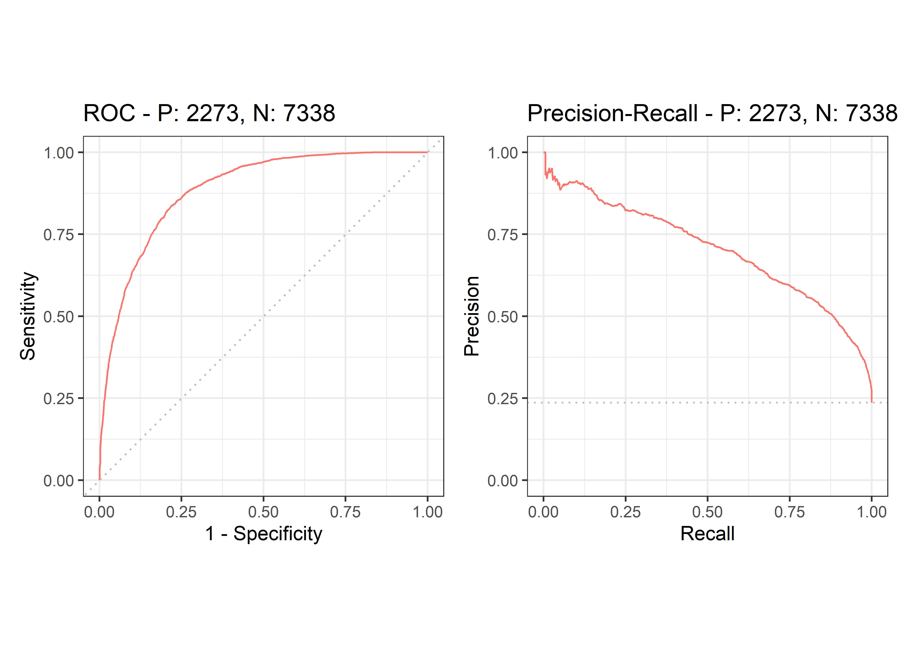

# m6APrediction

使用 Practical 5 已训练的 Random Forest，对单个位点或批量 RNA 特征预测 m6A。提供两个公开函数和一个内部 DNA 编码函数。模型不在预测时重新训练。

## 安装

```r
install.packages("remotes")
remotes::install_github("Trajectory614/m6APrediction")
library(m6APrediction)
```

## 批量预测

```r
library(m6APrediction)
ml_fit <- readRDS(system.file("extdata", "rf_fit.rds", package="m6APrediction", mustWork=TRUE))
feature_df <- read.csv(system.file("extdata", "m6A_input_example.csv", package="m6APrediction", mustWork=TRUE))
prediction_multiple(ml_fit, feature_df[1:3, ], positive_threshold=0.6)
```

## 单条预测（可独立运行）

```r
library(m6APrediction)
ml_fit <- readRDS(system.file("extdata", "rf_fit.rds", package="m6APrediction", mustWork=TRUE))
prediction_single(ml_fit, 0.6, "mRNA", "CDS", 12, 5, 0.8, "GGACA", 0.5)
```

## 输入和结果

CSV 必须有 gc_content、RNA_type、RNA_region、exon_length、distance_to_junction、evolutionary_conservation、DNA_5mer 七列。四个连续特征为有限数值；长度与距离已作 log2 转换，不要再转换。RNA_type 为 mRNA/lincRNA/lncRNA/pseudogene；RNA_region 为 CDS/intron/3'UTR/5'UTR。DNA_5mer 为五个大写 A/T/C/G 字符，训练数据中心碱基为 A。

批量函数保留输入列，增加数值 predicted_m6A_prob 和字符 predicted_m6A_status；单条函数返回同名的两个元素组成的字符向量，计算时须显式 as.numeric()。仅概率严格大于阈值时为 Positive。概率是森林投票比例，不代表经过独立校准的临床概率。

本地 Practical 5 模型的前三行概率为 0.610、0.014、0.180；以上单条示例为 0.528。与课程参考模型数值不同，不修改模型来迎合参考答案。100 行示例仅验证软件运行，不能用来证明独立预测性能。

## 课程背景：Practical 3 的 ROC 与 PRC

下图来自 **Practical 3 作业 Task 2** 的原始 `precrec` 输出。该随机森林使用 `m6A_imbalanced.csv` 的 38,444 行训练，在同一数据来源中随机留出的 9,611 行上评价（2,273 阳性、7,338 阴性）。原作业记录的 AUROC 为 0.8864，AUPRC 为 0.7042。



**这些结果仅适用于 Practical 3 作业模型。** 包内 `rf_fit.rds` 来自 Practical 5：它使用全部 48,055 行训练，并额外纳入 `nt_pos3`。因此，上图中的 9,611 行也参与了包内模型训练，不能用作当前 `m6APrediction` 模型的独立性能验证。

此仓库尚未发布。
